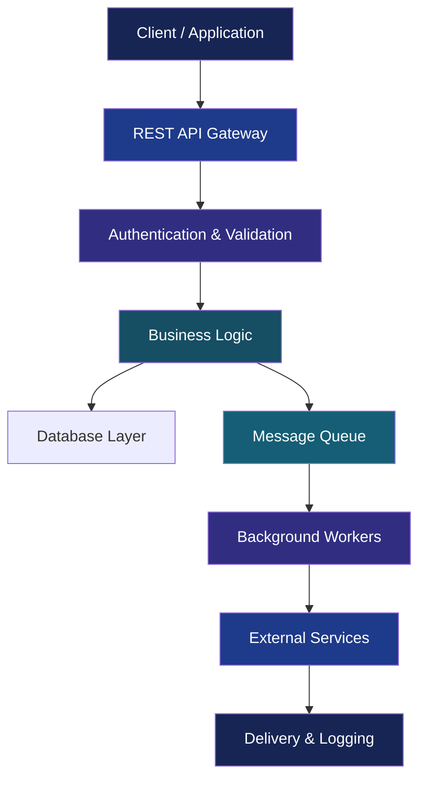
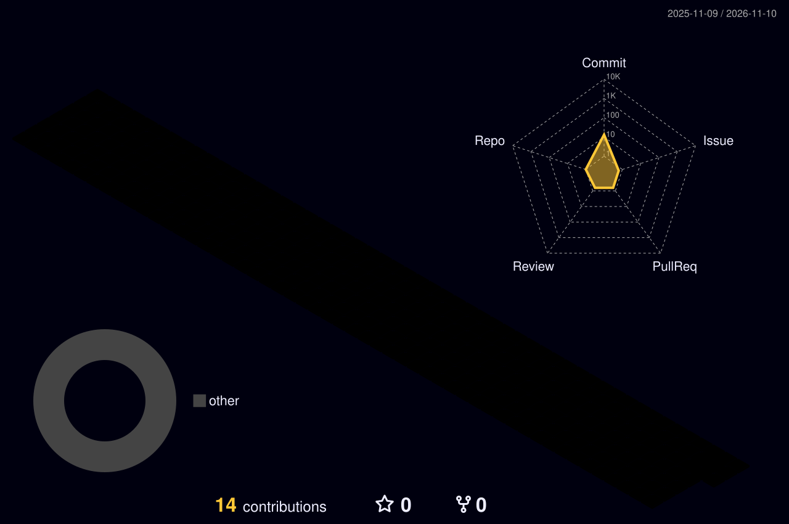

<!-- ======================================================
     NEXUS 2.0 | AKHIL VASISTA
     FUTURISTIC ENGINEERING PROFILE
====================================================== -->

<div align="center">

<!-- HERO -->


<br/>


<br/><br/>

<a href="https://github.com/akhilvasista">

</a>
<a href="mailto:akhil1999vasista@gmail.com">

</a>

<br/>


</div>

---

<!-- 01 ABOUT -->

<div align="center">


</div>

<table>
<tr>
<td width="58%" valign="top">

### Hello, I'm Akhil Vasista.

I'm a Full Stack Developer based in Bengaluru, India, with 2+ years of software development experience.

I focus on building backend services, asynchronous processing systems, scalable APIs and modern full-stack applications.

My engineering interests include:

- Backend architecture and microservices.
- Event-driven and distributed systems.
- Cloud infrastructure and deployment.
- Modern frontend engineering.
- AI-powered software solutions.

**My philosophy:** Understand the problem. Design the system. Build it reliably.

</td>
<td width="42%" valign="top">

### `developer.config`

```yaml
developer:
  name: Akhil Vasista
  role: Full Stack Developer
  location: Bengaluru, India

engineering:
  backend: Node.js
  frontend: React / Next.js
  language: JavaScript / TypeScript
  cloud: AWS
  infrastructure: Docker

interests:
  - System Design
  - Microservices
  - Distributed Systems
  - AI Engineering

mindset: Continuous Learning
```

</td>
</tr>
</table>

---

<!-- 02 TECH STACK -->

<div align="center">


<br/>

*An ecosystem of tools, technologies and engineering practices.*

<br/>

### BACKEND ENGINEERING


`REST APIs` · `Microservices` · `BullMQ` · `RabbitMQ` · `Socket.IO`

<br/>

### FRONTEND ENGINEERING


<br/>

### DATABASES & MESSAGE PROCESSING


<br/>

### CLOUD & INFRASTRUCTURE


<br/>

`AWS SES` · `SNS` · `S3` · `EC2` · `Lambda`

<br/>

### DEVELOPMENT & DELIVERY


</div>

---

<!-- 03 PROJECTS -->

<div align="center">


<br/>

*Selected engineering projects and practical implementations.*

</div>

<table>
<tr>
<td width="50%" valign="top">


### 01. Notification Microservice

A configurable, event-driven notification engine supporting multi-channel communication and asynchronous delivery.

**Core engineering:**

- Email, SMS, Push and In-App delivery.
- Dynamic templates and notification rules.
- Delayed and recurring scheduling.
- Retry, fallback and idempotency.
- Worker-based background processing.
- Real-time notification delivery.

**Stack:** Node.js, TypeScript, MongoDB, Redis, BullMQ, RabbitMQ, Socket.IO, AWS, FCM, MSG91, Docker.

</td>
<td width="50%" valign="top">


### 02. Leave Management System

A full-stack HR workflow application designed to streamline leave management and employee attendance.

**Core engineering:**

- Employee, Manager and Super Admin roles.
- JWT authentication and RBAC.
- Automated leave accrual.
- Carry-forward policy automation.
- Attendance and Excel reports.
- Docker and CI/CD integration.

**Stack:** React, Node.js, Express, MongoDB, JWT, Node-Cron, ExcelJS, Docker, GitHub Actions.

</td>
</tr>
<tr>
<td width="50%" valign="top">


### 03. AI Hospital Reception Agent

An AI-powered reception assistant designed to handle patient queries and provide context-aware appointment information.

**Core engineering:**

- Natural-language patient interaction.
- Doctor and department discovery.
- Appointment availability.
- Date and time-specific slot discovery.
- Automated deployment pipeline.

**Stack:** Python, OpenAI API, AI Agents, CI/CD.

</td>
<td width="50%" valign="top">


### 04. Web Application Engineering

Modern web application development with frontend architecture, backend integrations and database-driven workflows.

**Engineering focus:**

- Next.js application development.
- TypeScript-based architecture.
- MongoDB integration.
- Responsive user interfaces.
- API integration and application workflows.

**Stack:** Next.js, React, TypeScript, Node.js, MongoDB.

</td>
</tr>
</table>

<div align="center">

<a href="https://github.com/akhilvasista?tab=repositories">

</a>

</div>

---

<!-- 04 ARCHITECTURE -->

<div align="center">


### How I approach backend engineering

</div>



*Illustrative architecture representing concepts used in my backend engineering work.*

---

<!-- 05 ANALYTICS -->

<div align="center">


<br/>

*My public GitHub activity and contribution insights.*

<br/>


<br/><br/>


<br/><br/>


</div>

---

<!-- 06 3D SPACE -->

<div align="center">


<br/>

*Every contribution represents progress.*

<br/>



<br/><br/>


</div>

---

<!-- 07 CONNECT -->

<div align="center">


<br/><br/>

### Interested in building something meaningful?

I'm interested in connecting with engineering professionals, developers and teams working on impactful software products.

<br/>

<a href="mailto:akhil1999vasista@gmail.com">

</a>

<a href="https://github.com/akhilvasista">

</a>

<a href="https://www.linkedin.com/in/YOUR-LINKEDIN-USERNAME/">

</a>

<br/><br/>


<br/>


<sub>Designed with engineering passion by Akhil Vasista · Bengaluru, India</sub>

</div>
